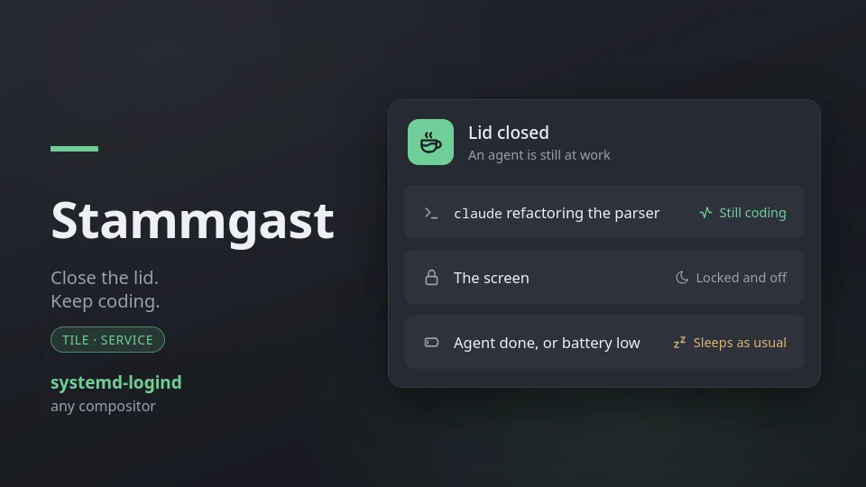

# Stammgast — close the lid, keep coding

**A [Noctalia](https://noctalia.dev) shell plugin that keeps a laptop working
with the lid shut while an AI agent is at it**: start Claude Code or Codex,
close the lid for the walk to class, and it is still coding when you get there.
The screen is locked and off in the meantime.



A *Stammgast* is the regular who is still at their table when the waiter starts
stacking the chairs. Closing time does not apply to them, and a closed lid does
not apply to your agent.

- **Hand off a task and walk away.** Give Claude Code a refactor, close the
  lid, go to class. It keeps going the whole way, and so does a remote-control
  session you steer from your phone.
- **Nothing to switch on.** Stammgast notices the agent by itself and holds the
  lid only while one runs. With no agent, closing the lid suspends the laptop
  exactly as before.
- **Safe in the bag.** Once the lid is shut the screen locks and goes dark. When
  you quit the agent, or the battery reaches 15 %, the laptop goes to sleep on
  its own, so it does not cook in a backpack with nothing to do.
- **No root, no config files.** It asks logind politely through
  `systemd-inhibit`, the way a video player keeps the screen on. Disable the
  plugin and every hold is gone.
- **See what your agents are up to.** A bar icon shows the agent that matters
  most, Claude Code's own little mascot included, with a dot for what it is
  doing: working, waiting for you, or idle. A card for the desktop or the
  lock screen lists every agent with its project and, if you like, the usage
  limits Claude and Codex report.

## Why a plugin

Closing the lid suspends the laptop, and a suspended laptop runs nothing: the
agent stops mid-task, and a remote session drops. Setting the lid to "ignore"
for good means a laptop that never sleeps in the bag, even with nothing to do.

Stammgast keeps the lid working as usual except while an agent is running. It
asks logind to leave the lid switch alone through `systemd-inhibit`, which any
user in the active session may do, so nothing needs root or a change to
`logind.conf`, and it lets go again as soon as the agent is done.

## Plugin

| Field | Value |
| --- | --- |
| ID | `137-trimethylxanthin/stammgast` |
| Entries | Service: `watch`; shortcut: `toggle`; bar widget: `bar`; desktop widget: `desktop` |

## Requirements

- **systemd-logind** handling the lid, which is the default on almost every
  distribution. If your compositor turns the lid into its own action (a
  Hyprland `bindl` on `switch:on:Lid Switch`, say), Stammgast cannot stop that.
- `systemd-inhibit` and `busctl` (systemd), `ps` and `pkill` (procps), and `awk`.

Missing tools are reported when the plugin starts.

## Usage

Enable it and forget it. Every three seconds it looks for a running agent; while
there is one:

- **Lid open.** Only the lid switch is held. Idle, locking and a manual suspend
  work as before.
- **Lid closed.** Sleep and idle are held too, or the idle timer would still
  suspend the laptop in the bag. The screen is locked and turned off, as a
  suspend would have done. Opening the lid turns the screen back on; the lock
  stays.
- **Agent gone, lid still closed.** Stammgast lets go, and logind carries out
  its usual lid action, normally suspend. If six seconds later it has not,
  Stammgast asks for that action itself, so the laptop does not stay awake in a
  bag with nothing to do.

**An open agent counts, busy or not.** Stammgast looks at processes, not at
what they do, so `claude` waiting at its prompt after finishing the task keeps
the laptop awake just like one at work. That is what keeps a remote session
(Claude Code's remote control, `codex` driven from a phone) alive, and it is
why you should quit the agent, or end its session, when you want the laptop to
sleep. The battery floor is the safety net for when you forget.

### The tile

Add it under **Settings → Control Center shortcuts**. It is lit while Stammgast
holds the lid. Click steps through three modes:

| Mode | |
| --- | --- |
| **auto** | Hold while an agent runs (the default) |
| **always** | Hold whatever runs, like the lid set to "ignore"; the battery floor still applies |
| **off** | Never hold |

Right-click opens the settings. The mode is remembered across restarts.

### The bar icon

Add **Stammgast** under **Settings → Bar**. It shows the agent that matters
most right now, one that is waiting for you before one at work before one at
its prompt:

| | |
| --- | --- |
| Icon | Claude Code's mascot, the OpenAI mark for Codex, the Copilot logo, the Google G for Gemini, a sparkle for any other agent; faded while it idles |
| Dot | **Active** (primary colour, pulsing), **waiting for you** (tertiary), **idle** (grey) |
| Number | How many agents run, when more than one |
| No agent | A coffee cup: Stammgast is there and watching (lit in *always* mode, crossed out when *off*) |

Its tooltip lists every agent with what it is doing, for how long and in which
project, and whether the lid is held. Click steps through the modes, like the
tile; right-click opens the settings.

**Where the states come from.** Claude Code keeps a small file per running
session (`~/.claude/sessions/<pid>.json`) that says whether it is busy, idle
or waiting for an answer, and Stammgast reads that. Every other agent says
nothing of the kind, so for them CPU use decides between *active* and *idle*,
and *waiting* does not appear.

### The desktop and lock-screen card

Add **Stammgast** in the desktop widget editor (**Settings → Desktop → Toggle
Editor**, or `noctalia msg desktop-widgets-edit`, on an empty workspace), or
on the lock screen under **Settings → Security → Lock screen → Toggle
Editor**. It shows:

- whether the lid is held, or the laptop will sleep when closed;
- every agent with its icon, what it is doing and for how long, its project and
  session name, and, for Claude Code with the status line set up, the model,
  how full the context is and what the session has cost;
- the usage limits Claude Code and Codex report: the current session window
  and the week, how much is used and when each resets.

Two settings per card, **Show projects** and **Show usage limits**, trim it.
**Show projects is on by default; turn it off for a card on the lock screen**,
which anyone who picks up the laptop can read: it hides project and session
names, model and cost, and leaves which agents run and what they are doing.

### Usage limits (optional)

**Codex** writes its limits into its own session logs, so they show up by
themselves.

**Claude Code** hands them only to its status line. To see them, let
Stammgast's status line script have a look first. In `~/.claude/settings.json`:

```json
"statusLine": {
  "type": "command",
  "command": "sh ~/.local/state/noctalia/plugins/data/137-trimethylxanthin/stammgast/claude-statusline.sh"
}
```

Stammgast puts the script there when it starts. It keeps a copy of what Claude
Code sends in `$XDG_RUNTIME_DIR/stammgast/claude/` and prints a short status
line (model and context). If you already have a status line, put its command
after the script's, and it gets the same input and prints the line instead:

```json
"command": "sh ~/.local/state/noctalia/plugins/data/137-trimethylxanthin/stammgast/claude-statusline.sh node ~/my-statusline.js"
```

Without it the card shows everything but Claude's limits, model and cost.

### Keybinds

The `watch` service takes these events over IPC:

```sh
noctalia msg plugin 137-trimethylxanthin/stammgast:watch all toggle
noctalia msg plugin 137-trimethylxanthin/stammgast:watch all auto
noctalia msg plugin 137-trimethylxanthin/stammgast:watch all always
noctalia msg plugin 137-trimethylxanthin/stammgast:watch all off
```

## Settings

| Setting | Default | |
| --- | --- | --- |
| AI agents | `claude, codex, gemini, opencode, aider, crush, goose, cursor-agent, qwen, amp, copilot` | Program names, separated by commas |
| Ignore command lines containing | `--chrome-native-host` | Parts of a command line, separated by commas, that make a process a helper rather than an agent |
| Battery floor | `15` | Percent at which it lets go on battery; it holds again 5 points higher or on mains. It always lets go at 5 %, whatever this says, so the system's own critical-battery action is never blocked |
| Lock when the lid closes | On | |
| Screen off when the lid closes | On | |

**How an agent is recognised.** By the name of the program (`claude`,
`/home/me/.local/bin/claude`), or, for a script run by `node`, `bun`, `deno` or
`python`, by the script's name or the npm package it belongs to, with a `-cli`
at the end dropped: `node …/node_modules/@google/gemini-cli/dist/index.js` is
`gemini`. To see what a tool runs as:

```sh
ps -eo pid=,args= | grep -i yourtool
```

Claude Code's Chrome bridge, `claude --chrome-native-host`, runs for as long
as Chrome does, which is why it is ignored by default.

## Notes

**Heat.** A laptop working in a closed bag gets warm, and some vent through the
keyboard, which the closed lid covers. Stammgast lets go when the agent is done
and at the battery floor, but a long task in a tight sleeve is still a long
task in a tight sleeve.

**A hold cannot outlive the plugin.** The inhibitor runs a shell that writes
to Noctalia every five seconds; if Noctalia or the plugin goes away, the next
write fails and logind drops the lock. Disabling Stammgast releases it at
once. `systemd-inhibit --list` shows it as *Stammgast* while it holds.

**Docked.** With an external monitor, logind's `HandleLidSwitchDocked`
(normally "ignore") already keeps the laptop awake, with or without Stammgast.
Someone is at that screen, so Stammgast holds only the lid switch, leaving idle
and suspend to them, and neither locks nor turns off the screens. Plugging a
screen in while the lid is closed turns the screens back on.

**False positives.** A program that shares an agent's name counts too: the
`amp` text editor, say, or a database tool called `goose`. Take such a name out
of **AI agents** if you use one.

**Tests.** `./tests/stammgast/run.sh` covers the agent details (Claude's
session files and status lines, CPU-based states, a wrapper and its child
counted once, Codex's limits, the widgets' icons and wording) and the decisions: which command
lines are agents (native binaries, npm packages run by node, bun or uv,
helpers to ignore), reading the lid, dock and batteries, the battery floor and
its slack, and what to hold in each mode. It also runs `watch.luau` against a
fake Noctalia host through lid closings and openings, agents coming and going,
the battery floor, docking, modes, refused commands, an inhibitor logind
refuses, disable and reload, and the snapshot and lid-action shell scripts
against fake `ps`, `busctl` and `systemctl`. In a live Noctalia 5.2 session on Hyprland it
has held and released the lid switch for a running Claude Code, followed the
modes over IPC, and let go when its pipe closed. Closing a real lid is the part
still to be checked by hand.
