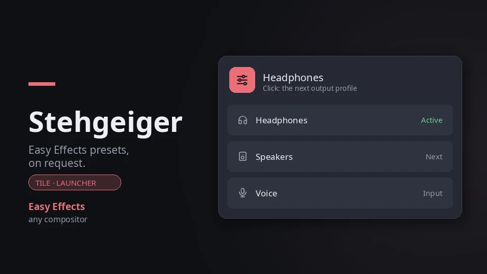

# Stehgeiger — Easy Effects presets, on request

**A [Noctalia](https://noctalia.dev) shell plugin that switches
[Easy Effects](https://github.com/wwmm/easyeffects) presets** from a
control-center tile, the launcher or one key: headphones, speakers, a
microphone chain, whatever presets you have made.



The *Stehgeiger* is the standing violinist in a Viennese café, who walks from
table to table and plays what the guests request. This one plays your Easy
Effects presets: click the tile and the next one is on.

## Why a plugin

Easy Effects can load a preset per device on its own, which is all you need as
long as every pair of headphones is its own sound card. Plug two of them into
the same DAC, or switch between headphones and speakers on the same output,
and Easy Effects sees one device: the preset has to be picked by hand, in its
window. Stehgeiger puts that pick on a tile, in the launcher and behind an IPC
call you can bind to a key.

## Plugin

| Field | Value |
| --- | --- |
| ID | `137-trimethylxanthin/stehgeiger` |
| Entries | Service: `control`; launcher provider: `provider`; shortcut: `cycle` |
| Launcher Prefix | `/eq` |

## Requirements

- **Easy Effects** 8 or newer (`easyeffects`), running as a service. Most of
  its effects come as LV2 plugins in separate packages: `lsp-plugins-lv2`
  (equalizer, compressor, gate, limiter) and `calf` (de-esser, exciter, bass
  enhancer). Without them the effects are greyed out in Easy Effects.
- Noctalia's plugin API 24.

A missing `easyeffects` is reported in the launcher and on the tile, and the
plugin stays idle.

## Setup

1. **Install Easy Effects** and the LV2 plugins, on Arch:

   ```sh
   sudo pacman -S easyeffects lsp-plugins-lv2 calf
   ```

2. **Run it as a service.** Turn on *Start service at login* in Easy Effects'
   settings, or start it from your compositor's autostart:

   ```sh
   easyeffects --service-mode
   ```

   Stehgeiger never starts Easy Effects itself (see [Notes](#notes)).

3. **Make your presets in Easy Effects**: one output preset per pair of
   headphones or speakers, input presets for your microphone if you like.
   They are saved as `~/.local/share/easyeffects/output/<name>.json` and
   `.../input/<name>.json`, and that is where Stehgeiger finds them.

4. **Optionally, pick and name them** under **Settings → Plugins →
   Stehgeiger** (see [Settings](#settings)). Left empty, every preset is
   offered under its own name.

## Usage

**The tile.** Add the `cycle` shortcut under **Settings → Control Center
shortcuts**. It shows the output profile that is on; a click loads the next
one, and after the last one the first. It shows what Easy Effects says is
loaded, so a preset picked in the Easy Effects window shows up too, within ten
seconds. With Easy Effects stopped the tile says *Stehgeiger* and does
nothing. There is no right-click.

**The launcher.** Type `/eq`. Every output profile and every input profile is
a row, followed by the presets the profiles leave out (an A/B variant you
don't want on the tile, say); the loaded ones are marked **Active**, and
picking a row loads it. Typing filters on the label and on the preset name.

**Keybinds.** The `control` service takes these events over IPC:

```sh
noctalia msg plugin 137-trimethylxanthin/stehgeiger:control all set-output <preset>
noctalia msg plugin 137-trimethylxanthin/stehgeiger:control all set-input <preset>
noctalia msg plugin 137-trimethylxanthin/stehgeiger:control all cycle-output
```

`set-output` and `set-input` take a preset name, the file name without
`.json`; any preset in that directory works, also one left out of the
profiles setting. `cycle-output` does what a click on the tile does. In
`hyprland.lua`:

```lua
hl.bind("SUPER + F9", hl.dsp.exec_cmd("noctalia msg plugin 137-trimethylxanthin/stehgeiger:control all cycle-output"))
```

## Settings

| Setting | Default | |
| --- | --- | --- |
| Output profiles | empty | `Label=preset` pairs, separated by commas, in the order the tile cycles through them, e.g. `Headphones=headphones-eq, Speakers=speakers-flat`. A bare `preset` is its own label. Empty: every output preset, alphabetically, by name |
| Input profiles | empty | The same for input presets, shown in the launcher |

A configured preset that has no file is left out, and so is an entry with
nothing before or after the `=`. Presets not in the list stay loadable from
IPC, from the end of the launcher list and from Easy Effects itself; the list
decides what the tile cycles through and what the launcher puts first.

## Hearing safety

Stehgeiger switches presets, nothing else. It never turns effects on or off,
never touches Easy Effects' bypass, and never starts or stops Easy Effects.
There is deliberately no bypass button anywhere in it.

That matters because of how a sensible set of output presets is built: an
equalizer that boosts some frequencies needs a cut in front of it (a negative
input gain, the preamp of an AutoEq curve) so it cannot clip. Give every
output preset the **same** cut, in the equalizer's own input gain, and
switching between them never makes things louder. Then:

- **Easy Effects stopped or crashed means no cut, so louder.** With Easy
  Effects not running, sound goes straight to the device, a few dB louder than
  through any of your presets. Turn the volume down before you start or
  restart Easy Effects, and after a crash.
- **Keep the equalizer on.** Switching the equalizer off in Easy Effects, or
  bypassing it there, takes its input-gain cut away with it. A "flat" preset
  should be an equalizer with no bands and the same cut, not an equalizer
  that is off.
- **Turn the volume down when you change headphones or the DAC's gain.** The
  same cut equalizes digital headroom, not loudness: headphones differ in
  sensitivity and impedance, and a DAC's high-gain setting is much louder.
  Picking a profile does not turn a knob for you.

## Notes

**It never starts Easy Effects.** Without a running Easy Effects service,
`easyeffects -a output` (and every other `easyeffects` call) does not answer
and exit: it turns into a full Easy Effects instance, window and all, and
keeps running. After a crash or a `kill -9`, the service's socket is left
behind and the same happens. So before every call Stehgeiger checks, in one
short process, that the socket is there **and** that an `easyeffects` process
is running, and calls Easy Effects only then. Otherwise it shows *Easy Effects
is not running* and asks again ten seconds later.

**What it runs.** Every ten seconds that check and `easyeffects -a output`;
`-a input` only while the launcher is open and after an input switch; `easyeffects -l <preset>` when you
switch, followed straight away by another look. If a call fails it waits a
minute before asking again. Presets are listed from Easy Effects' preset
directories, not by asking Easy Effects. It makes no network calls and writes
no files.

**One race it cannot close.** If Easy Effects is quitting at the very moment
the service asks it what is loaded, the question can land in the gap where
Easy Effects has let go of its lock but has not yet finished exiting. The
`easyeffects` call then becomes a new instance itself, window and all. The
service cuts every call off after five seconds, so that stray instance is
gone again within five seconds; it loads your last preset, so it is never
louder than what you were hearing. Measured on Easy Effects 8.3.2: about one
call in sixty during a quit. Reading the state through Easy Effects' own
socket would avoid it, but that needs `socat`, and the plugin adds no
dependencies.

**Tests.** `./tests/stehgeiger/run.sh` covers the decisions: reading what
`easyeffects -a` prints, using the real answers of Easy Effects 8.3.2 with and
without its service and with a stale socket (`tests/stehgeiger/fixtures/`),
the profiles setting, the order and the next profile, and when to ask again.
The service and its IPC events have been run in a live Noctalia 5.4 session
with Easy Effects 8.3.2 on Hyprland.
